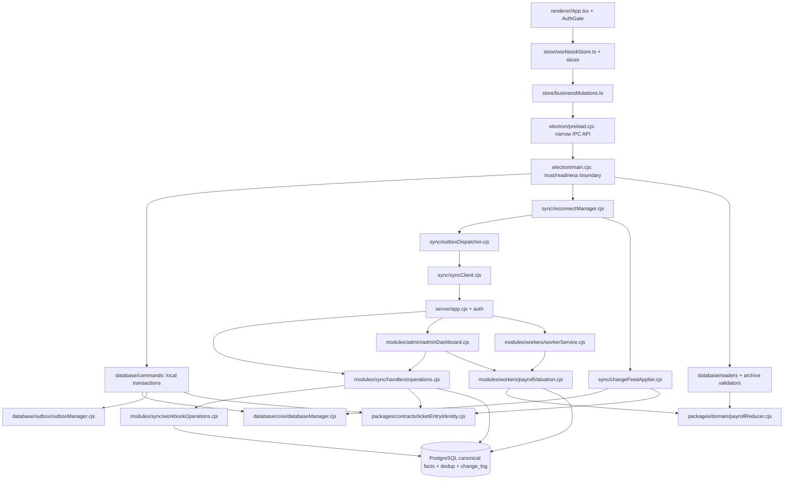
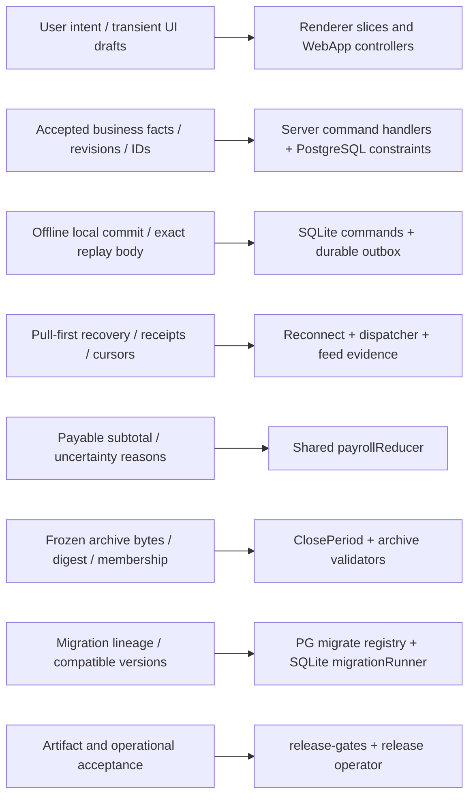
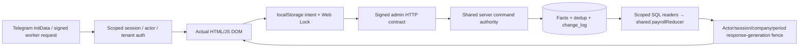
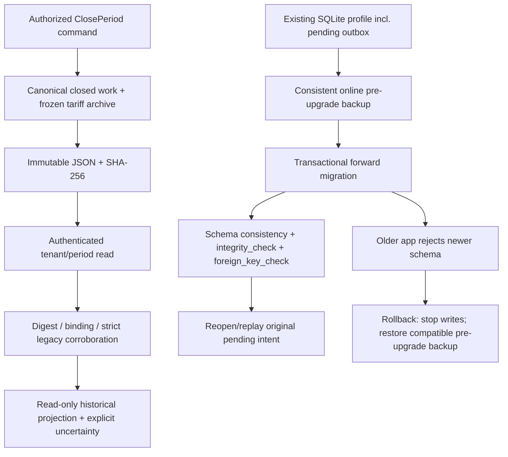

# Phase 3 — module dependencies, ownership and data flow

Scope: `D:\hisob-new`, 2026-11-11. Preserve Phase 1/2 behavior. This is a code-ownership
map, not an invented list of human/team owners. Runtime entrypoints and state boundaries
were traced manually; `scripts/verify/release/architecture-inventory.cjs` supplies the
file-level literal-import graph and source hashes.

The inventory excludes tests and vendor/generated directories. It inventories Python
files but does not parse Python imports. Computed imports, HTML script tags, IPC,
HTTP, SQL and DOM events are NOT ordinary import edges. Type-only declarations are
excluded from cycle detection; inline mixed type imports may overapproximate. Zero
cycles in that graph does not prove absence of every runtime dependency problem.

## 1. Module dependency map



**Confirmed cycle removed:** `SheetTabs → OperationRatesModal → OperationRatesView
→ SheetTabs`. A pure navigation classification (`isModelNarxsiz`) lived in the
navigation component and was consumed by its modal child. It now lives in
`renderer/domain/modelRateStatus.ts`; the old export remains compatible. Zero-price
navigation categorization is unchanged and is NOT payroll's known-zero rule.

**Confirmed broken edge fixed:** `scripts/verify/database/migration-pg-9a.cjs` used
`../../ops/...`, which resolves below `scripts/`, not the repository root. It now
imports the source-owned migration registry directly. Running that container-specific
acceptance still requires its designated disposable fixture; resolving its import is
not the same as recertifying every mode of that older harness.

## 2. Ownership map



- **UI intent:** `store/slices/*`, `authStore.ts`, `sessionGuard.ts`; web admin
  `admin.js` and `financial-intent.js`. Drafts are not accepted financial facts.
  Session/company ownership must survive every asynchronous boundary. Web Locks and
  durable intent markers coordinate tabs; they do not replace server idempotency.
- **Canonical mutations:** `server/modules/sync/handlers/operations.cjs`,
  `workbookOperations.cjs`, `workers/workerCreation.cjs`; PG dedup, revision/sequence
  locks and tenant-bound constraints own final acceptance. Worker IDs are assigned
  by the server. Admin WebApp writes reuse this authority rather than writing a
  separate financial model.
- **Offline durability:** `database/commands/commandPipeline.cjs` and
  `workbookCommandPipeline.cjs` atomically write local facts and the outbox. A local
  success is not a server receipt. `outboxManager.cjs` owns transitions/provenance.
- **Synchronization:** `reconnectManager.cjs`, `outboxDispatcher.cjs`,
  `changeFeedApplier.cjs`, `feedEvidence.cjs`, `bootstrapApplier.cjs`. Unknown HTTP
  outcomes retain original IDs/body. Status lookup and replay establish acceptance;
  feed watermarks establish freshness. Projections must not certify themselves.
- **Financial calculations:** `packages/domain/payrollReducer.cjs` owns shared
  arithmetic and uncertainty. Server `payrollValuation.cjs` and desktop
  `payrollReader.cjs` supply scoped facts and tariff evidence. Current periods use
  current tariffs; closed periods use frozen closing tariffs. Original entry-rate
  snapshots remain immutable evidence, not a competing payable-rate policy.
  `scripts/verify/database/payroll-oracle.cjs` is deliberately independent.
- **Historical correction attribution:** explicit original work links and immutable
  evidence, not current names/dates/amount similarity. New read-only
  `historical-reconciliation.cjs` classifies evidence; it has no mutation route.
- **Archive authority:** PG `ClosePeriod` freezes the archive; SHA and tenant/period
  binding are checked independently on reads. Legacy membership may be corroborated
  canonically, but never written back into immutable JSON. Historical baseline
  uncertainty remains explicit. Viewing an archive does not reopen it for writes.
- **Profile/database identity:** `databaseManager.cjs` owns the canonical file path,
  not merely company ID. This prevents restore/upgrade profiles sharing connections.
  `migrationRunner.cjs` rejects future schema versions; it never auto-downgrades.
- **Authentication:** device auth + operator auth for desktop commands; scoped admin
  sessions and signed worker routes for WebApps/bots. `main.cjs` validates the active
  tenant; renderer-supplied company/license settings are not trusted authority.
- **Print boundary:** `PattaBatchView`/`PattaPrintModal` own preview and batch intent;
  main process owns print transport. SQLite/PG own numbered batches. A spool callback
  cannot prove physical label quality or actual paper delivery.
- **Diagnostics:** `runtime/diagnostics.cjs` owns bounded operational events and fatal
  main-process termination. It does not log financial payloads, URLs, tokens, SQL or
  arbitrary renderer text. Existing API/service observability is a separate concern.
- **Release:** source fingerprint, artifact SHA, repeatable local evidence and
  `release-gates.cjs` determine technical evidence completeness. Hardware/staging and
  historical-business signoffs require accountable human acceptance, not agent claims.

## 3. Data-flow diagrams

### Desktop financial command, failure and recovery

```mermaid
sequenceDiagram
  participant UI as Renderer intent/session guard
  participant IPC as Preload → main readiness/tenant
  participant SQL as SQLite transaction/outbox
  participant Sync as Pull-first reconnect
  participant API as HTTP auth + command validation
  participant PG as PG transaction + dedup + feed
  UI->>IPC: Command ID + operation ID + expected revision
  IPC->>SQL: BEGIN IMMEDIATE; facts + exact canonical outbox body
  SQL-->>UI: Local committed projection; sync status not certified
  Sync->>API: Pull / status lookup / dispatch original command
  API->>PG: Lock/revision check; mutation + dedup receipt + change_log
  PG-->>API: COMMIT
  alt Response lost / process crash
    API--xSync: Outcome unknown
    Sync->>SQL: Retain original body/IDs across restart
    Sync->>API: Status/replay same intent
    API->>PG: Dedup returns existing result; no second money fact
  end
  API-->>Sync: Receipt and ordered feed evidence
  Sync->>SQL: Verify/apply/acknowledge; persist cursor atomically
  SQL-->>UI: Reload projection + labelled payroll subtotal/freshness
```

### Admin and worker financial reads/writes



Real Telegram transport was NOT called during these local acceptances. Local signed
routes and browser storage/locks are real; Telegram envelopes were synthetic.

### Archive and upgrade safety



Server facts committed after a backup are NOT rolled back by restoring SQLite.
Recovery must reconnect and reconcile receipts/feed before accepting new financial
intent. Never reset PostgreSQL to make a restored desktop appear current.

## 4. Debt deliberately not rewritten

- `main.cjs`, both command pipelines, server `operations.cjs`, `admin.js` and several
  large React views still combine substantial responsibilities. Size alone is not
  evidence that a rewrite is safe; incremental extraction needs isolated invariants.
- Desktop/server validation and SQL readers necessarily differ at trust/storage
  boundaries. Shared arithmetic/identity is explicit; merging these layers would
  blur authorization and accepted-evidence ownership.
- The universal render fixture remains large and has unrecertified modes. New gates
  use scoped runners and explicit completion evidence rather than trusting exit 0.
- A shared root package/build config couples server tooling and desktop dependencies.
  Candidate package contents are inspected; a new multi-package build system was not
  introduced speculatively.
- SQLite managed-cache hits still run integrity checks. Under a backup-sized workload
  these can increase IPC latency. Do not remove data-integrity checks merely to make
  a timing test green; measure and define a startup/hot-path health policy first.
- Independent oracle coverage still rejects resolved production corrections rather
  than silently ignoring them. General independent correction/reversal certification
  remains debt even though synthetic production regressions exist.

This map documents verified boundaries and confirmed improvements, not exhaustive
absence of dead code, business contradictions or technical debt.
